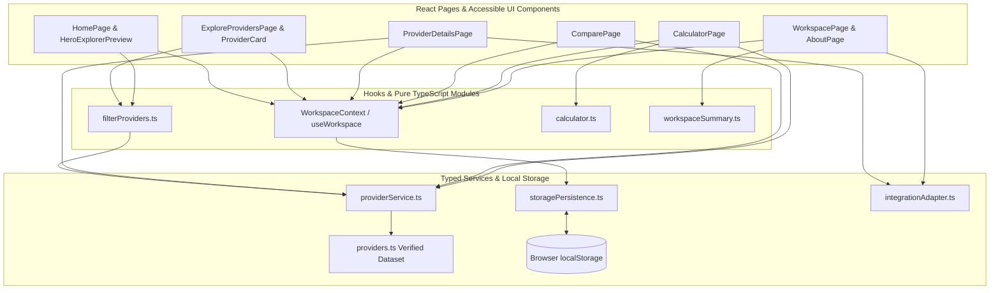

# PROJECT REPORT
## 100GB — Unified Cloud Explorer: Cloud Storage Discovery, Plan Comparison, and Local-First Personal Workspace

---

## 1. Title Page Information (Placeholders for College Submission)

- **Project Title:** 100GB — Unified Resource & Cloud Explorer (URCE)
- **Course / Subject:** Mini Project — Computer Science and Engineering (Web Application Development)
- **Submitted By:** VIVEK VISWANADHAPALLI - Roll No:23NG1A05C7
- **Department:** Department of Computer Science & Engineering
- **Institution:** Usha Rama College Of Engineering And Technology
- **Faculty Guide:** Mr. CH. Phani Kumar, Assistant Professor
- **Academic Year:** 2023-2027

---

## 2. Abstract

Personal cloud storage has become foundational infrastructure for students, software developers, and professionals. While numerous providers advertise free storage tiers, practical usability is governed by nuanced technical conditions — including shared email/photo quotas, conditional onboarding checklists, strict single-file upload limits, connected-device caps, and differing encryption key models. **100GB — Unified Resource & Cloud Explorer (URCE)** is a modular React and TypeScript web application engineered to solve cloud plan fragmentation without requiring user registration, backend databases, or third-party credential sharing. The system combines **V1 (Cloud Discovery)** — featuring a verified nine-provider directory, multi-attribute filtering, side-by-side plan comparison, and a binary gigabyte Storage Calculator — with **V2 (Personal Cloud Workspace)**, providing `localStorage`-persisted provider selections, favorites, folder allocation notes, official web app launchers, and a typed OAuth 2.0 PKCE adapter specification for future live integrations.

---

## 3. Introduction

Individuals routinely maintain files across several cloud ecosystems: Google Drive for collaborative academic documents, Microsoft OneDrive for Windows Office integration, MEGA or Proton Drive for end-to-end encrypted personal records, and Box or Dropbox for lightweight folder synchronization. Despite this multi-cloud reality, users rarely have a transparent, non-promotional tool to evaluate free storage conditions side by side or remember how they partitioned their files across services.

100GB addresses this gap as a unified exploration and personal organization workspace. Importantly, 100GB does not act as a cloud storage host or claim to merge separate providers into a single virtual hard drive; instead, it empowers informed technical choices backed by official provider documentation.

---

## 4. Problem Statement

Prospective cloud storage users face three recurring problems:
1. **Opaque Free-Tier Conditions:** Marketing headlines frequently conflate unconditional base storage with referral bonuses, temporary promotional space, or quotas shared with email attachments and mobile photo backups.
2. **Inaccurate Capacity Estimation:** Everyday users know roughly how many photos or videos they have on a phone or laptop, yet struggle to convert media counts and megabyte averages into gigabyte requirements and match them against single-file upload limits (such as Box Individual’s 250 MB cap).
3. **Lack of Private Organization:** Existing multi-cloud managers typically require creating yet another account and granting broad read/write OAuth permissions to third-party servers just to keep track of preferred providers.

---

## 5. Existing System and Limitations

Currently, users evaluate cloud plans through two primary channels:
- **Individual Provider Marketing Pages:** Accurate for single services, but structured inconsistently across vendors and requiring manual cross-referencing to spot caveats (e.g., whether zero-knowledge encryption is included on the free tier or locked behind a paid add-on like pCloud Crypto).
- **Commercial Affiliate Review Blogs & Multi-Cloud Aggregators:** Review blogs often contain outdated free storage figures (such as discontinued promotional tiers) without citing primary pricing pages, while cloud file transfer aggregators require server-side account linking that privacy-conscious users avoid.

---

## 6. Proposed System

**100GB — Unified Cloud Explorer** introduces a client-side, source-attributed platform built around truthfulness and clarity:
- Separates free capacity into **Standard Base Free**, **Conditional Starter-Step Space**, **Shared Ecosystem Pools**, and **Referral Ceilings**.
- Provides live client-side search, verified capability toggles (`Zero-knowledge E2EE free`, `Native Linux desktop client`, `Dedicated drive quota`), and deterministic sorting.
- Computes storage requirements in real time (`1 GB = 1,024 MB`) and flags incompatibilities such as single-file upload size limits.
- Stores the user’s **Personal Cloud Workspace** (saved services, favorites, comparison sets, and folder purpose notes) in schema-validated browser `localStorage` while clearly distinguishing web app launch links from live OAuth API connections.

---

## 7. Objectives

1. Construct a maintainable, strongly typed data model representing nine major cloud storage providers with primary source URLs and verification dates.
2. Design a clean, accessible user interface adhering to WCAG AA contrast, keyboard navigation, reduced-motion preferences, and tabular numeric alignment.
3. Implement accurate mathematical validation and unit conversion in the Storage Calculator.
4. Achieve reliable client-side persistence across browser reloads using defensive JSON parsing and ID sanitization.
5. Prepare an extensible TypeScript integration adapter contract documenting OAuth 2.0 PKCE requirements for future V3 enhancements.

---

## 8. Scope

### Implemented Scope (V1 & V2)
- **V1 — Cloud Discovery:** Home landing experience with interactive 3-pane Explorer preview (`/`), Provider Directory (`/providers`), Provider Details (`/providers/:id`), Side-by-Side Comparison (`/compare`), and Storage Requirement Calculator (`/calculator`).
- **V2 — Personal Cloud Workspace:** Persistent Saved Workspace and Favorites manager (`/workspace`), per-provider folder allocation notes, allowance calculation mode toggle (*Immediate Base Free* vs *With Starter Steps*), official Web Launch actions, and Project/Architecture documentation (`/about`).

### Out of Current Scope (Planned V3)
- Live OAuth 2.0 token exchange, remote cloud file browsing, cross-cloud file transfers, and user account registration.

---

## 9. Functional Requirements

- **FR-01:** Display all nine target providers (Google Drive, Microsoft OneDrive, Dropbox, MEGA, Box, pCloud, Proton Drive, Sync.com, Internxt) with verified storage figures and official links.
- **FR-02:** Filter providers dynamically by search query, minimum base storage (`0`, `5`, `10`, `15` GB), free zero-knowledge encryption, native Linux client availability, and dedicated (non-shared) quota.
- **FR-03:** Sort providers by base storage (ascending/descending), starter-step storage, and alphabetical order.
- **FR-04:** Render detailed provider views and display a helpful not-found state for unrecognized provider IDs.
- **FR-05:** Compare between 2 and 4 user-selected providers side by side, with preset loading, removal, and reset controls.
- **FR-06:** Calculate total required storage from photo count, average photo MB, video count, average video MB, documents GB, and optional buffer GB while rejecting negative or non-numeric inputs.
- **FR-07:** Persist saved workspace providers, favorites, comparison lists, and custom notes in `localStorage` across page reloads.

---

## 10. Non-Functional Requirements

- **NFR-01 (Usability & Responsiveness):** Usable across mobile (`360px+`), tablet (`768px+`), laptop, and wide desktop (`1440px`) viewports without unintended horizontal overflow.
- **NFR-02 (Accessibility):** Semantic landmarks (`<header>`, `<nav>`, `<main>`, `<footer>`), skip-to-content link, `aria-pressed` / `aria-live` states, explicit form `<label>` bindings, and visible `:focus-visible` outlines.
- **NFR-03 (Portability):** Zero external database, Docker, or secret API key dependencies; builds and runs identically on Windows, macOS, and Linux with Node.js LTS.
- **NFR-04 (Honesty & Data Integrity):** Never fabricate live connection states or combine unverified promotional claims into base storage totals.

---

## 11. System Architecture

### Architectural Diagram



### User Workflow Sequence

```text
[Discover (/providers)] ---> Search / Filter by E2EE, Linux, Base GB
         |
         v
[Inspect (/providers/:id)] -> Check Plan Limits, Upload Caps & Official Sources
         |
         +---> [Calculate (/calculator)] -> Convert Photos/Videos (MB) to Target GB
         |
         +---> [Compare (/compare)] ------> Side-by-Side Matrix (2 to 4 Providers)
         |
         v
[Organize (/workspace)] ----> Save Selection + Folder Notes in localStorage
                              & Launch Official Provider Web Apps Safely
```

---

## 12. Module Descriptions

1. **`src/types/cloud.ts`:** Defines all TypeScript enums (`VerificationStatus`, `IntegrationStatus`, `AllowanceType`) and interfaces (`CloudProvider`, `WorkspacePreferences`, `StorageCalculatorInputs`).
2. **`src/data/providers.ts`:** Contains the curated records, platform matrices, security profiles, limitations, and primary documentation URLs for the nine cloud providers.
3. **`src/lib/filterProviders.ts`:** Pure, stateless search, capability filtering, and immutable sorting engine.
4. **`src/lib/calculator.ts`:** Validates user form strings, converts megabytes to gigabytes (`MB_PER_GB = 1024`), computes category shares, and evaluates provider fit tiers and upload-size warnings.
5. **`src/lib/workspaceSummary.ts`:** Computes deduplicated base and starter-step totals across saved providers and generates contextual caveats.
6. **`src/services/storagePersistence.ts`:** Reads and writes `100gb_workspace_preferences_v1` in `localStorage` while stripping unknown provider IDs and recovering safely from malformed JSON.
7. **`src/services/integrationAdapter.ts`:** Defines `CloudProviderAdapter` and documents OAuth 2.0 PKCE scopes (`drive.metadata.readonly`, `Files.Read`, `account_info.read`) vs. zero-knowledge client vaults.
8. **`src/components/` & `src/pages/`:** Modular presentation layer implementing all eight routes, custom vector brand/provider graphics, toast notifications, and accessible dialogs.

---

## 13. Technology Stack Summary

| Layer | Technology | Purpose |
| :--- | :--- | :--- |
| Core UI | React `^19.0.1` | Component rendering & declarative state |
| Type System | TypeScript `^7.0.2` | Compile-time type checking & interfaces |
| Bundler | Vite `^8.3.0` | Fast ES module dev server & production bundler |
| Routing | `react-router-dom` | Client-side SPA routing across 8 routes |
| Styling | Tailwind CSS `^4.3.3` | Utility styling + CSS custom property tokens |
| Icons | `lucide-react` `^0.546.0` | Consistent stroke icons |
| Testing | Node `node:test` + `tsx` | Automated unit & integration verification |

---

## 14. Data Model

Each `CloudProvider` record enforces the following key structure:
- **Identity:** `id`, `name`, `shortTagline`, `description`, `brandAccentHex`
- **Allowance (`FreeAllowanceDetails`):** `baseFreeGB`, `onboardingFreeGB`, `referralMaxGB`, `allowanceType`, `sharedAcrossEcosystem`, `conditionSummary`, `uploadAndTransferLimits`
- **Capabilities:** `planLimitations: string[]`, `verifiedFeatures: string[]`, `platforms: PlatformSupportEntry[]`
- **Security (`SecurityProfile`):** `zeroKnowledgeOnFree`, `encryptionModel`, `twoFactorAuth`, `openSourceClients`, `jurisdiction`, `verifiedHighlights`
- **Provenance:** `officialWebsite`, `officialPricingUrl`, `webLaunchUrl`, `sources: ProviderSourceAttribution[]`, `lastVerifiedDate`, `verificationStatus`, `integrationStatus`

---

## 15. Methodology

1. **Source Research & Verification:** Each provider’s official pricing and documentation pages were reviewed to separate permanent Day-1 free capacity from onboarding tasks, shared email pools, and referral programs.
2. **Design System First:** Color tokens (`#155EEF` cobalt, `#14243A` deep navy, `#22D3EE` cyan, `#FAFAF7` main background), typographic scale (`Plus Jakarta Sans`, `Manrope`, `JetBrains Mono` with `tabular-nums`), and vector brand assets (`favicon.svg`, `.ico`, `.png`) were established prior to page assembly.
3. **Pure Logic Isolation:** Filtering, sorting, storage math, and persistence sanitization were written as pure TypeScript modules independent of React DOM so they can be verified deterministically via automated tests.

---

## 16. Use Cases

1. **UC-01 — Student Coursework Backup:** A student uses `/calculator` to estimate `3.95 GB` of lecture PDFs, code zips, and reference images, filters `/providers` for services with `5 GB+` free storage, and compares Google Drive vs. OneDrive vs. Box.
2. **UC-02 — Linux Developer Seeking Encrypted Vault:** A Linux user filters `/providers` by `Zero-knowledge E2EE free` + `Native Linux desktop client`, immediately identifying MEGA (`20 GB`) and Internxt (`1 GB`), and inspects full Linux package details on `/providers/mega`.
3. **UC-03 — Multi-Provider Workspace Partitioning:** A user saves Google Drive, MEGA, and Proton Drive in `/workspace`, records personal folder purpose notes for each service, reviews the informational base total (`37 GB`), and launches each official web app directly.

---

## 17. Testing Strategy and Actual Results

Testing combined automated Node.js unit/integration tests, static TypeScript type-checking, and full Vite production compilation.

### Executed Commands and Actual Results

1. **Automated Test Suite (`npm test`):**
   - **Command:** `node --import tsx --test tests/core.test.ts`
   - **Actual Result:** **4 test suites, 13 tests executed — 13 passed, 0 failed** (`duration_ms: ~458 ms`).
   - **Coverage Verified:**
     - All 9 required provider records exist with valid HTTPS links and verified capacities.
     - Integration adapters never falsely report `connected: true`.
     - Default sorting, zero-knowledge E2EE filtering, native Linux filtering, and keyword/threshold filtering return exact expected provider sets.
     - Binary calculator conversion (`1,024 MB = 1 GB`), negative/non-numeric error flagging, and Box’s `250 MB` single-file warning behave accurately.
     - `localStorage` persistence deduplicates IDs, strips unknown IDs, recovers from corrupted JSON, and computes base (`17 GB`) vs. starter-step (`20 GB`) summaries accurately.

2. **Static Type Analysis (`npm run lint`):**
   - **Command:** `tsc --noEmit`
   - **Actual Result:** **Exited with code 0 (0 TypeScript errors).**

3. **Production Build Verification (`npm run build`):**
   - **Command:** `vite build`
   - **Actual Result:** **Succeeded with 0 errors**, generating production HTML, CSS, JavaScript bundles, and static favicon assets in `dist/`.

---

## 18. Security and Privacy Considerations

- **Zero Credential Harvesting:** 100GB never asks for cloud account emails, passwords, or recovery keys.
- **Safe External Navigation:** All external links to provider websites use `target="_blank"` with `rel="noopener noreferrer"` to prevent `window.opener` tab-nabbing.
- **Defensive Local Storage Parsing:** `loadWorkspacePreferences()` validates types, caps note lengths to 280 characters, and whitelists provider IDs before hydrating React state.
- **Honest Integration Reporting:** Unsupported live connections are explicitly labeled *Not connected · Official web launch* or *Not connected · OAuth adapter planned*.

---

## 19. Limitations

1. Provider plan data represents verified snapshots (`2026-10-24`); cloud vendors may alter free storage quotas, inactivity rules, or transfer caps without prior notice.
2. Preferences saved in `localStorage` remain local to a single browser profile and device unless manually recreated.
3. Free tiers across separate providers cannot be mounted as one unified filesystem inside a web browser; large single files cannot span multiple accounts.

---

## 20. Future Enhancements

1. **Backend OAuth 2.0 PKCE Microservice (V3):** Implement secure authorization-code-with-PKCE flows for providers offering public APIs (Google Drive, OneDrive, Dropbox, Box, pCloud) to display real-time used vs. remaining bytes.
2. **JSON Workspace Portability:** Add one-click JSON export and schema-checked import for Personal Workspace notes and selections.
3. **Paid Plan Comparison Mode:** Extend the comparison matrix and calculator to evaluate paid `100 GB`, `200 GB`, and `2 TB` tiers.

---

## 21. Conclusion

**100GB — Unified Cloud Explorer** demonstrates how disciplined software architecture, source-attributed data modeling, and thoughtful interface design can solve a practical everyday problem without overpromising capabilities. By combining transparent V1 cloud discovery tools with a local-first V2 Personal Cloud Workspace, the project provides immediate utility for students and everyday users while establishing a clean engineering foundation for future API integrations.

---

## 22. References (Official Sources Used)

1. Google One — *Official Storage Plans*: https://one.google.com/about/plans
2. Google Drive — *Product Overview*: https://www.google.com/drive/
3. Microsoft OneDrive — *Compare Cloud Storage Plans*: https://www.microsoft.com/en-us/microsoft-365/onedrive/compare-onedrive-plans
4. Dropbox — *Dropbox Basic (Free) Plan Specifications*: https://www.dropbox.com/basic
5. MEGA — *Official Plans and Pricing*: https://mega.io/pricing
6. Box — *Individual & Personal Plan Pricing*: https://www.box.com/pricing/individual
7. pCloud — *Cloud Storage Pricing & Plans*: https://www.pcloud.com/cloud-storage-pricing.html
8. Proton Drive — *Official Pricing & Security Architecture*: https://proton.me/drive/pricing and https://proton.me/drive/security
9. Sync.com — *Official Plans & Privacy Overview*: https://www.sync.com/pricing/
10. Internxt — *Internxt Drive Official Pricing*: https://internxt.com/pricing
11. React Documentation: https://react.dev/
12. Vite Documentation: https://vite.dev/
13. React Router Documentation: https://reactrouter.com/
14. Tailwind CSS Documentation: https://tailwindcss.com/
